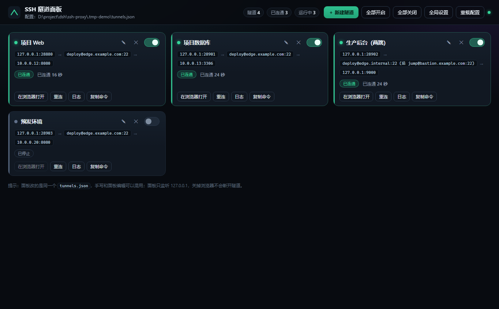
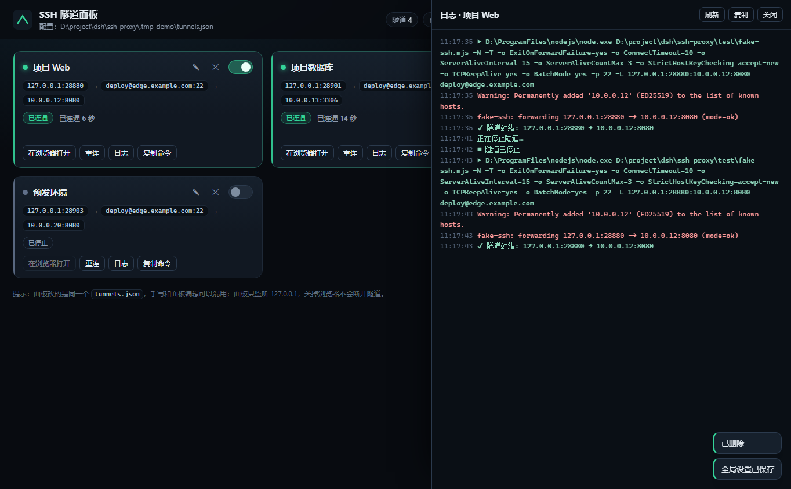
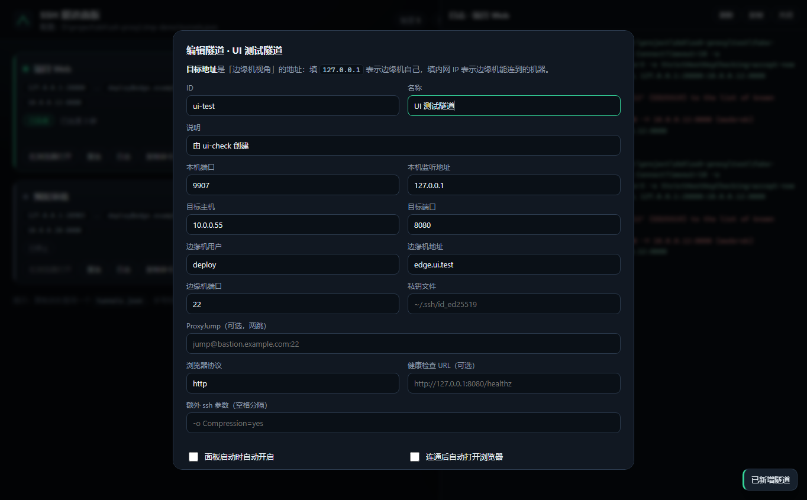
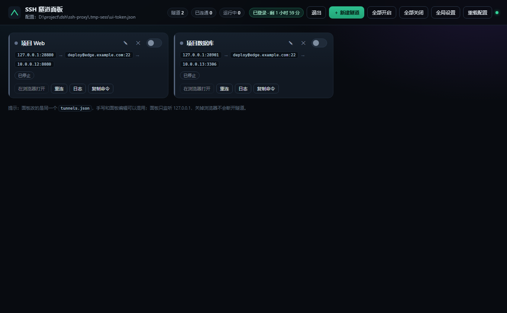

# SSH 隧道面板（ssh-proxy-panel）

把 `ssh -N -L` 本地端口转发变成一个开关：**点一下开、点一下关，不占终端窗口，断线自动重连，开机自动挂起**。
隧道的增删改、登录凭据、SSH 认证方式都能在网页面板里改，也可以打包成一个 exe 常驻托盘。

```
┌──────────────────── 你的电脑（Windows / macOS / Linux）────────────────────┐
│                                                                          │
│   浏览器 ──HTTP──► 面板 127.0.0.1:7788  ◄── 托盘 exe（可选）               │
│                      │                                                   │
│                      │ 托管：spawn / 监控 / 退避重连 / 回收孤儿            │
│                      ▼                                                   │
│              ssh -N -L 127.0.0.1:8080:10.0.0.12:8080 deploy@edge …        │
│                      │ ① 加密隧道（密钥 / 密码 / 连接时输入）              │
└──────────────────────┼───────────────────────────────────────────────────┘
                       ▼
              边缘机 / 跳板机 edge.example.com:22
                       │ ② 从边缘机视角再连内网
                       ▼
              项目服务 10.0.0.12:8080（只监听内网/127.0.0.1，公网不可达）
```

浏览器访问 `http://127.0.0.1:8080` 就等于访问了那台内网服务；关掉浏览器，隧道照样在跑。



---

## 目录

- [1. 为什么需要"面板"](#1-为什么需要面板)
- [2. 快速开始](#2-快速开始)
- [3. 配置：tunnels.json](#3-配置tunnelsjson)
- [4. 面板](#4-面板)
- [5. 登录与会话](#5-登录与会话)
- [6. 命令行](#6-命令行)
- [7. 打包成单个 exe（托盘）](#7-打包成单个-exe托盘)
- [8. 开机自启](#8-开机自启)
- [9. 可靠性](#9-可靠性)
- [10. 安全](#10-安全)
- [11. 面板应该跑在哪](#11-面板应该跑在哪)
- [12. 排错 FAQ](#12-排错-faq)
- [13. 目录结构与测试](#13-目录结构与测试)
- [14. 已知限制](#14-已知限制)
- [许可与贡献](#许可与贡献)

---

## 1. 为什么需要"面板"

`ssh -N -L 8080:127.0.0.1:8080 deploy@edge` 本身没问题，问题是它**前台运行**：占一个终端窗口，Ctrl+C 就断，
网络抖动不自愈，端口通不通也不知道，多个服务就要开多个窗口。

| 做法 | 不占窗口 | 自愈 | 端口占用检测 | 看状态 | 一键开关 |
|---|---|---|---|---|---|
| `ssh -f -N -L` | ✅ | ❌ | ❌ | ❌ | ❌（还得 `ps` 找 pid） |
| `autossh -M 0 -f` | ✅ | ✅ | ❌ | ❌ | ❌ |
| 图形 SSH 客户端 | ✅ | 部分 | ✅ | ✅ | 点界面（不可脚本化） |
| **本方案** | ✅ | ✅ | ✅ | ✅ | ✅（也能 `curl`） |

核心差别：把 ssh 从"人肉前台"变成**被托管的服务**，托管者只做三件事——起、看、拉回来。

---

## 2. 快速开始

### A. 用打包好的 exe（Windows）

双击 `dist/ssh-proxy.exe` → 托盘出现绿色小箭头，控制器在后台跑（无控制台窗口）。
首次运行会在 exe 旁边生成 `tunnels.json`；右键托盘 →「编辑 tunnels.json」填边缘机和内网服务，
再双击托盘图标打开面板。

### B. 从源码跑（任意平台）

需要 Node.js ≥ 18，零依赖（`npm install` 只在打包时才需要）。

```powershell
node src/cli.mjs init          # 生成 tunnels.json（已存在则拒绝覆盖）
node src/cli.mjs serve --open  # 起面板并打开浏览器；或双击 start.cmd
```

打开 <http://127.0.0.1:7788/>，点 **＋ 新建隧道** 填表保存，然后把开关拨到"开"。

先验证配置对不对、不碰面板也可以：

```powershell
node src/cli.mjs cmd app     # 打印这条隧道等价的 ssh 命令，复制到终端也能跑
node src/cli.mjs status      # 看所有隧道状态（需要面板在跑）
```

---

## 3. 配置：`tunnels.json`

最小可用：

```json
{
  "tunnels": [
    {
      "id": "app",
      "name": "项目 Web",
      "localPort": 8080,
      "target": { "host": "10.0.0.12", "port": 8080 },
      "via": { "user": "deploy", "host": "edge.example.com", "port": 22, "identityFile": "~/.ssh/id_ed25519" }
    }
  ]
}
```

面板会把它翻译成：

```bash
ssh -N -T -o ExitOnForwardFailure=yes -o ConnectTimeout=10 \
    -o ServerAliveInterval=15 -o ServerAliveCountMax=3 \
    -o StrictHostKeyChecking=accept-new -o TCPKeepAlive=yes -o BatchMode=yes \
    -p 22 -i ~/.ssh/id_ed25519 -L 127.0.0.1:8080:10.0.0.12:8080 deploy@edge.example.com
```

### 3.1 隧道字段

| 字段 | 必填 | 默认 | 说明 |
|---|---|---|---|
| `id` | | `tunnel-N` | 唯一标识，字母数字 `.` `_` `-`；面板和 CLI 都用它 |
| `name` / `description` | | 同 `id` / 空 | 面板上显示的名字与悬停提示 |
| `localPort` | ✅ | — | **本机**监听端口 |
| `bindAddress` | | `127.0.0.1` | 本机监听地址；改 `0.0.0.0` 才能给局域网用（见 §10） |
| `target` | ✅ | — | `{ "host", "port" }` 或 `"host:port"`。**这里的 host 是"边缘机视角"的地址** |
| `via` | ✅ | — | `{ user, host, port, identityFile, proxyJump, proxyCommand, knownHostsFile }`，也支持 `"deploy@edge.example.com:22"` |
| `via.proxyJump` | | 空 | 两跳，如 `"jump@bastion.example.com:22"` |
| `auth` | | `{mode:"key"}` | 隧道到边缘机的认证方式，见 §3.3 |
| `scheme` | | `http` | "在浏览器打开"用的协议 |
| `url` | | 空 | 打开路径：`/admin/login?x=1` 或完整 `https://…`；空 = 根路径 |
| `autoStart` | | `false` | 面板启动时自动开启 |
| `openOnUp` | | `false` | 连通后自动打开浏览器 |
| `healthUrl` | | 空 | 用 HTTP 探活代替 TCP 探活 |
| `extraArgs` / `env` | | `[]` / `{}` | 追加给 ssh 的参数 / 环境变量 |

### 3.2 全局字段

```json
{
  "panel": {
    "host": "127.0.0.1",
    "port": 7788,
    "token": "",
    "sessionTtlMinutes": 720,
    "sessionIdleMinutes": 120,
    "openOnStart": false
  },
  "ssh": {
    "bin": "ssh",
    "connectTimeout": 10,
    "serverAliveInterval": 15,
    "serverAliveCountMax": 3,
    "strictHostKeyChecking": "accept-new",
    "batchMode": true,
    "extraArgs": []
  },
  "supervision": {
    "startTimeoutMs": 9000,
    "watchIntervalMs": 5000,
    "maxFailures": 12,
    "backoffBaseMs": 1000,
    "backoffMaxMs": 30000,
    "stableResetMs": 60000
  }
}
```

- `panel.token`：面板访问令牌，留空 = 本机直接打开（详见 §5）。**优先级：`SSH_PROXY_TOKEN` > `--token` > 配置文件**。
- `panel.sessionTtlMinutes` / `sessionIdleMinutes`：登录会话的绝对到期 / 闲置失效（见 §5）。
- `ssh.batchMode`：`true` 时禁止交互式提示。纯密钥/agent 场景必须开着，否则 ssh 会卡在提示符上。
- `supervision.*`：起停与自愈策略（见 §9）。

### 3.3 隧道到边缘机的三种认证

| 方式 | 配置 | 凭据在哪 | 何时问你 |
|---|---|---|---|
| **私钥**（默认，推荐） | `"auth": { "mode": "key", "identityFile": "~/.ssh/id_ed25519" }` | 私钥文件；口令可交给 ssh-agent，或加密存 `auth.passphrase` | 有 agent 就永不问 |
| **存储密码** | `"auth": { "mode": "password", "password": "enc:v1:…" }` | 配置里只有**密文** | 不问，自动用 |
| **连接时输入** | `"auth": { "mode": "ask" }` | **只在内存** | 每次连接弹框问你 |

密码/口令怎么交给 ssh：面板设 `SSH_ASKPASS` + `SSH_ASKPASS_REQUIRE=force`，凭据通过环境变量递给 ssh 需要密码时执行的
小帮手（`.ssh-proxy/askpass.cmd`）。所以凭据**不进命令行、不进日志、不进运行时文件**；密码模式用
`BatchMode=no` + `PreferredAuthentications=password,keyboard-interactive`，纯密钥模式仍是 `BatchMode=yes`。

**"存储密码"加密**：AES-256-GCM，密钥是 `.ssh-proxy/secret.key`（32 字节，首次生成，尽量收紧权限）。
配置文件里只有 `enc:v1:<iv>:<tag>:<密文>`。这挡的是"配置文件被拷走/贴进聊天窗"，能读你用户目录的人仍能读到 key；
真要更强就用密钥登录。

**"连接时输入"**：只存在面板进程内存里，点停止或重启面板即忘，配置文件里一个字节都没有。

```bash
node src/cli.mjs secret app     # 不开面板也能送一次密码（面板在跑即可）
```

> `SSH_ASKPASS_REQUIRE` 需要 OpenSSH ≥ 8.4；Windows 上 `SSH_ASKPASS` 必须能被 `CreateProcess` 直接执行，
> 面板会自动生成 `askpass.cmd` 包一层（Windows OpenSSH 9.5 实测可用）。版本太老会 `Permission denied`，这时用 ssh-agent 或升级。

---

## 4. 面板

- **开关**：每条隧道一个开关，状态持久化到 `.ssh-proxy/state.json`，控制器重启后恢复。
- **实时状态**：`已停止 / 连接中 / 已连通 / 重连中 / 已暂停 / 等待密码`，附已连通时长、重连次数、下次重连倒计时。
- **一键全部开/关**、**重载配置**（手工改过文件时用）。
- **在浏览器打开**：隧道一通即可点，直达 `http://127.0.0.1:<端口><url>`（深链接见 §3.1）。
- **边缘机信息脱敏**：首页默认把 `deploy@edge.example.com:22` 显示成 `d***y@e***.com:22`（IP 显示 `203.***.***.45`），
  端口保留；右上角「显示边缘机 / 隐藏边缘机」一键切换，选择记在浏览器。编辑器、「复制命令」和日志里仍是真实值。
- **日志抽屉**：ssh 的 stderr 原样保留并实时追加；点抽屉外面任何地方、或按 Esc 就能关。
- **登录与退出**：配了凭据时顶栏显示「密钥登录 · 剩 X」和 **退出** 按钮（见 §5）。



### 4.1 面板里改配置

左上「＋ 新建隧道」、卡片右上 `✎` / `✕`、顶栏「全局设置」，改完**直接写回同一个 `tunnels.json`**。

| 行为 | 说明 |
|---|---|
| 只动这一条 | 只改 `tunnels` 里对应的一项，顶层 `panel`/`ssh`/`supervision` 和未知字段原样保留 |
| 保留手写字段 | `env`、`sshBin` 等面板表单没有的字段不会被吃掉 |
| 先校验再写 | 端口范围、`id` 唯一、`via.host` 必填都在落盘前校验；不通过返回 400 且**文件一个字不动** |
| 原子写入 | 临时文件 + `rename`，不会出现半个 JSON |
| 立即生效 | 改端口/目标/跳板/凭据 → 该隧道自动重建；只改名字/说明 → 不打断连接 |
| 改名保状态 | 改 `id` 等于"旧删新增"，原来开着的状态会带过去 |

两处例外：`panel.host`、`panel.port`、`panel.token`、会话时效属于"门户参数"，**保存后需重启面板**才生效
（否则会当场把你自己踢下线）。



### 4.2 HTTP 接口

有 `panel.token` 时，脚本请求带 `x-panel-token: <token>`；浏览器走登录后的会话 Cookie。

| 方法 | 路径 | 说明 |
|---|---|---|
| GET | `/healthz` | 健康检查（免鉴权）：`{ ok, up, authRequired, methods, tokenSource, version }` |
| GET | `/api/state` | 全部隧道快照 |
| GET | `/api/events` | SSE 实时推送（`state` / `log`） |
| GET | `/api/config` | 完整配置（表单用） |
| POST | `/api/tunnels` | 新增隧道 |
| PUT | `/api/tunnels/:id` | 修改（body 里 `id` 不同 = 改名） |
| DELETE | `/api/tunnels/:id` | 删除 |
| POST | `/api/tunnels/:id/start` · `/stop` · `/restart` | 单条开关 |
| POST | `/api/tunnels/:id/secret` | 给"连接时输入"的隧道送一次密码 |
| GET | `/api/tunnels/:id/logs?lines=200` | 该隧道日志 |
| POST | `/api/all/start` · `/api/all/stop` | 全部开关 |
| GET/PUT | `/api/settings` | `ssh` / `supervision` + `panel` 的令牌与会话 |
| POST | `/api/reload` | 重载 `tunnels.json` |
| POST | `/api/shutdown` | 优雅退出（先停隧道再退） |

```bash
curl -X POST http://127.0.0.1:7788/api/tunnels \
  -H 'x-panel-token: 你的令牌' -H 'content-type: application/json' \
  -d '{"id":"app","localPort":8080,"target":{"host":"10.0.0.12","port":8080},
       "via":{"user":"deploy","host":"edge.example.com","port":22}}'
```

---

## 5. 登录与会话

### 5.1 三种面板凭据（可同时启用，登录框会出现页签）

| | 令牌 | 密码 | 密钥 |
|---|---|---|---|
| 存什么 | 明文 `panel.token` | **scrypt 哈希**（不可逆） | Ed25519 公钥；私钥在浏览器 IndexedDB，`extractable:false` |
| 文件泄露后 | 直接失守 | 推不出密码 | 只有公钥，仿不出签名 |
| 怎么配 | 改文件 / `--token` | `node src/cli.mjs passwd` | 面板里「注册本机密钥」/ `addkey` |

密钥登录的流程：浏览器生成一对 Ed25519（私钥不可导出），公钥注册给服务端；登录时服务端发一个
**2 分钟有效、只能用一次**的挑战，浏览器签名、服务端验签。不装任何东西，也不把私钥贴到任何地方。

> 注意：私钥是**浏览器里生成**的那把，不是你的 `~/.ssh/id_ed25519`（浏览器读不了本地文件）。
> 想用 SSH 私钥，得自己用 `ssh-keygen -Y sign` 之类对挑战签名，再用 `addkey` 注册公钥——面板只验签。

### 5.2 会话

```
登录（令牌 / 密码 / 本机密钥签名）──► 服务端发 HttpOnly Cookie（会话）
                                        │
   之后所有请求只带 Cookie（凭据不再出现在前端/URL）
                                        │
   顶栏「密钥登录 · 剩 7 小时」 ──► 到期 / 闲置 / 点退出 ──► 回登录框
```



| 行为 | 说明 |
|---|---|
| 绝对到期 | `panel.sessionTtlMinutes`（默认 720 分钟），到点必须重新登录 |
| 闲置超时 | `panel.sessionIdleMinutes`（默认 120 分钟），有请求就续期，但不突破绝对到期 |
| 退出 | 作废服务端会话 + 清 Cookie + 清"记住令牌"，刷新后**不会**自动登回去 |
| 记住令牌 | 只对令牌方式有效；密码和密钥不落明文 |
| 输错限流 | 连续错 5 次锁 30 秒 |
| 防 CSRF | 会话走 Cookie，所以 `POST/PUT/DELETE` 校验 `Origin` 必须与 `Host` 一致 |
| 重启即失效 | 会话只在内存里，面板重启 = 全部失效（故意的） |

---

## 6. 命令行

```powershell
node src/cli.mjs serve [--config tunnels.json] [--port 7788] [--host 127.0.0.1]
                       [--token <令牌>] [--open] [--quiet]
node src/cli.mjs status                 # 所有隧道状态
node src/cli.mjs up <id|all>            # 开
node src/cli.mjs down <id|all>          # 关
node src/cli.mjs restart <id>           # 重连
node src/cli.mjs logs <id> [行数]        # 看日志
node src/cli.mjs cmd <id>               # 打印等价 ssh 命令
node src/cli.mjs secret <id>            # 给"连接时输入"的隧道送一次密码
node src/cli.mjs reload                 # 重载配置
node src/cli.mjs init [文件名]           # 生成示例配置

node src/cli.mjs auth                   # 看当前启用了哪些登录方式
node src/cli.mjs passwd [--clear]       # 设置/清除登录密码（只存 scrypt 哈希）
node src/cli.mjs addkey --name 笔记本 --file ~/.ssh/id_ed25519.pub
node src/cli.mjs rmkey <id|指纹>         # 删除一把公钥
```

除 `serve` / `init` / 凭据命令外，其余都是**通过 HTTP 操作正在跑的面板**（所以面板得先开着），
这样 CLI 和网页看到的永远是同一份状态。CLI 免登录只支持 `panel.token`。

---

## 7. 打包成单个 exe（托盘）

```powershell
npm install                 # 只为打包（esbuild / postject）
node scripts/build-exe.mjs  # 产物在 dist/；--no-zip 可跳过压缩
```

| 产物 | 说明 |
|---|---|
| `dist/ssh-proxy.exe` | **就这一个**（约 89 MB）：托盘 + 内嵌 Node 控制器 + 内嵌前端 |
| `dist/tunnels.example.json` · `dist/使用说明.txt` | 示例配置、给最终用户的三步说明 |
| `dist/ssh-proxy-portable.zip` | 上面三个打成一个包（约 33 MB） |

**单文件怎么做到的**：控制器（Node SEA）和三个前端文件用 `csc /resource:` 内嵌进托盘 exe；首次运行解包到
`%LOCALAPPDATA%\ssh-proxy\runtime\<构建号>\`，之后直接复用；新版本解到新目录并清掉旧的。

- 配置 / 日志 / `.ssh-proxy\` 都在 **exe 旁边**；目录不可写（只读 U 盘）则退回 `%APPDATA%\ssh-proxy\`。
- `ssh-proxy.exe --prepare` 只解包不弹托盘，方便安装脚本或自检。
- 托盘菜单：打开面板 / 全部开启 / 全部关闭 / 重载配置 / 打开配置文件夹 / 编辑 tunnels.json / 退出；双击图标即打开面板。
- 控制器意外退出，托盘 3 秒内拉起；退出走 `POST /api/shutdown`，先停隧道再退。

改代码时别踩的点：SEA 只吃**单个 CJS**（`src/cli.mjs` 先被 esbuild 打成 `.build/cli.cjs`，用 `__SEA__` 区分打包态）；
打包后没有 `import.meta.url`（`src/app-root.mjs` 判断资源在项目目录还是 exe 旁边）；askpass 在打包版是
`<core.exe> --askpass`；前端是内嵌的，改了 `public/` 必须重新打包。

---

## 8. 开机自启

| 平台 | 做法 |
|---|---|
| Windows（源码） | `powershell -ExecutionPolicy Bypass -File scripts\install-autostart.ps1`（登录时隐藏窗口起 `node src\cli.mjs serve`） |
| Windows（exe） | 把 `ssh-proxy.exe` 的快捷方式丢进 `shell:startup`，或用同一个脚本把命令换成 exe |
| Linux | `cp scripts/ssh-proxy.service ~/.config/systemd/user/ && systemctl --user enable --now ssh-proxy`（`KillMode=control-group` 保证 ssh 子进程跟着退） |
| macOS | 登录项里加一条 `node …/src/cli.mjs serve --quiet` |

---

## 9. 可靠性

| 机制 | 行为 |
|---|---|
| 端口预检 | 开之前先试连 `localPort`，被占就直接报错，不会出现"ssh 在跑但你连的是别的东西" |
| 就绪判定 | 起 ssh 后轮询本机端口（或 `healthUrl`），通了才标「已连通」；`ExitOnForwardFailure=yes` 保证转发失败就退出 |
| 自动重连 | 进程退出 → 指数退避（1s→30s，带 ±15% 抖动） |
| 守护探活 | 每 5s 探一次已连通隧道的端口，连续 3 次不通就重建 |
| 卡死兜底 | 「连接中」超过约 24s 仍未就绪 → 杀掉重来 |
| 止损 | 连续失败超过 `maxFailures`（默认 12）→ 标「已暂停」，不再无脑重试（避免把边缘机 sshd 打进 fail2ban） |
| 孤儿回收 | 控制器被强杀后，下次启动校验命令行含本隧道 `-L` 规格再杀，不误杀别人的 ssh |
| 优雅退出 | Ctrl+C / 服务停止时先杀子进程再退（Windows `taskkill /T /F`，POSIX 杀进程组） |
| 状态持久化 | 哪条隧道该开着写在 `.ssh-proxy/state.json`，重启后恢复 |
| 配置热更新 | 保存/重载后按"新增→拉起、改动→重建、删除→停掉"处理 |
| 配置写保护 | 改配置前全量校验，不通过返回 400 且文件不动；写入用临时文件 + `rename` |
| 前端版本握手 | 静态资源带 `?v=`，`/healthz` 同报版本；页面落后会弹黄色提示条 +「立刻刷新」 |
| 弹层可见性回归 | UI 测试用 `getComputedStyle` + `elementFromPoint` 校验"弹层真不可见、卡片没被遮住" |
| 登录会话 | 令牌只用一次，之后是 HttpOnly Cookie；绝对到期 + 闲置超时 + 可退出 + 输错限流 |
| 隧道凭据 | 密码走 `SSH_ASKPASS`（不进命令行/日志）；存储密码 AES-256-GCM；"连接时输入"只进内存 |

---

## 10. 安全

前提：项目在公网、只有一个弱 token。正确姿势不是"把端口藏起来"，而是**让项目在公网上彻底不可达**，只留 SSH 一道门。

### 10.1 服务侧（收益最大）

```bash
# 1) 项目只监听回环，公网直接连不上（以 systemd 为例：ExecStart=... --bind 127.0.0.1:8080）
sudo ss -lntp | grep 8080      # 确认是 127.0.0.1:8080，不是 0.0.0.0:8080

# 2) 防火墙兜底：只放 22（改成非标端口更好）
sudo ufw default deny incoming && sudo ufw allow 22/tcp && sudo ufw enable
```

### 10.2 sshd 加固（边缘机）

```conf
PubkeyAuthentication yes
PasswordAuthentication no
KbdInteractiveAuthentication no
PermitRootLogin no
AllowTcpForwarding local        # 只允许本地转发
GatewayPorts no                 # 禁止把转发端口暴露到 0.0.0.0
ClientAliveInterval 30
ClientAliveCountMax 3

# 隧道专用账号再收一层：只准转发到这几个地址
Match User tunnel
    PermitOpen 127.0.0.1:8080 10.0.0.13:3306
    PermitTTY no
    ForceCommand /bin/false
```

私钥万一流失，`PermitOpen` 白名单也让它碰不到别的端口，不能当跳板扫内网。

### 10.3 面板侧

- 面板默认只绑 `127.0.0.1`，别的机器访问不到。要远程管就用 Tailscale/WireGuard 或先 SSH 进去，**别直接暴露公网**。
- 三种凭据安全性：**密钥 > 密码 > 令牌**。密钥私钥不出浏览器；密码只存 scrypt 哈希；令牌是明文共享密钥。
- `bindAddress` 保持 `127.0.0.1`；确实要给局域网用时才改 `0.0.0.0`，并配防火墙。
- 首页默认脱敏边缘机用户/地址，适合截图分享；编辑器、日志、复制命令里仍是真实值（要干活）。

### 10.4 可选：给项目再套一层强认证

短期改不动项目时，在边缘机上加一层真正的认证，隧道只是让你能访问那层：

```nginx
location / {
    auth_basic           "restricted";
    auth_basic_user_file /etc/nginx/.htpasswd;
    proxy_pass           http://127.0.0.1:8080;
}
```

---

## 11. 面板应该跑在哪

| 位置 | 适合 | 注意 |
|---|---|---|
| **你自己的电脑**（推荐） | 只有你用，随用随开 | 关机 = 隧道断，合情合理；开机自启见 §8 |
| **常开小主机/NAS** | 多人共用、手机也想访问 | 隧道绑在那台机器的 `127.0.0.1`；要给别的设备用需 `bindAddress: "0.0.0.0"` + 防火墙 + 面板凭据 |
| **公网服务器** | ❌ 不建议 | 面板 = 一个能在服务器上起进程的入口，暴露它等于送钥匙 |

---

## 12. 排错 FAQ

**配置文件里 `token` 是空的，打开面板却要登录？**
凭据有三个来源，优先级从高到低：`SSH_PROXY_TOKEN` → `--token` → `tunnels.json` 的 `panel.token`。
文件里空着不代表不要登录。

```powershell
curl http://127.0.0.1:7788/healthz        # {"authRequired":true,"tokenSource":"cli",...}
echo $env:SSH_PROXY_TOKEN
```

`tokenSource` 取值 `env` / `cli` / `file` / `none` 就是答案。第三种可能：**改完文件但没让面板重新读**，
`panel.token` 的改动要重载或重启才生效。

**面板更新了，浏览器里还是旧样子 / 一直停在登录框？**
看弹窗底部有没有「清除已保存的令牌」和「仍然进不去？看诊断信息」——没有就是**没刷新的旧页面**。
按 **Ctrl + Shift + R** 一次。现在页面版本落后时顶部会出现黄色提示条和「立刻刷新」。

**登录多久失效？怎么马上退出？**
默认 12 小时绝对到期 + 2 小时无操作失效（`panel.sessionTtlMinutes` / `sessionIdleMinutes`）。点顶栏 **退出** 立即作废；
没配任何登录方式时就没有"退出"（那种面板本来就不需要登录）。

**忘了令牌/密码？**
面板只监听本机，直接改文件即可：清空 `panel.token`、`panel.passwordHash`、`panel.publicKeys`，重启面板回到免登录；
或用 `node src/cli.mjs passwd` / `rmkey <id>` 重设。

**隧道连不上，日志是 `Permission denied`？**
先看卡片上的认证方式标签：`私钥` 检查 `auth.identityFile` 与口令（`ssh-add` 或 `auth.passphrase`）；
`密码` 确认 `auth.mode` 是 `password` 且密码已设置；`交互输入` 应该有个"输入密码"按钮，输入前状态是「等待密码」；
都不是就看 `ssh -V` 是否 ≥ 8.4（`SSH_ASKPASS_REQUIRE` 需要）。

**`Permission denied (publickey)`**
私钥没被用上。Windows 上确认 ssh-agent：

```powershell
Get-Service ssh-agent | Set-Service -StartupType Automatic
Start-Service ssh-agent
ssh-add $env:USERPROFILE\.ssh\id_ed25519
ssh -o BatchMode=yes deploy@edge.example.com true    # 能免密执行说明密钥通了
```

**`bind: Address already in use` / 面板提示"端口已被占用"**
本机端口被占了（可能是上次没退干净的 ssh）。换 `localPort`，或：

```powershell
Get-NetTCPConnection -LocalPort 8080 | Select-Object OwningProcess
taskkill /PID <pid> /T /F
```

**`administratively prohibited: open failed`**
边缘机 sshd 限制了转发：检查 `AllowTcpForwarding`、`PermitOpen`、`Match User` 规则。

**`Host key verification failed`**
服务器换了主机密钥或 `known_hosts` 有旧记录：`ssh-keygen -R "[edge.example.com]:22"`。

**显示"已连通"但网页打不开 / 502**
`target` 填错了。`-L` 的 target 是**边缘机视角**的地址：边缘机自己 → `127.0.0.1`；另一台内网机 → 它的 IP；
服务只监听 unix socket 则要先让它监听 TCP。

**提示"找不到 ssh 可执行文件"**
`ssh.bin` 配错了。面板会直接停下报错而不是无限重试；去「全局设置」改成真实存在的 `ssh` 或完整路径
（带空格的路径用引号包起来）。

**面板里保存时提示 400**
错误原文会显示在表单下方，文件**没被改动**。常见原因：`id` 重名、端口超范围、`via.host` 空着、密码格式不对。

**Windows 上留了一堆 `ssh.exe`**
面板重启时会自动回收（校验命令行后杀）。手动清理：`taskkill /IM ssh.exe /F`（会杀掉你所有 ssh，慎用）。

---

## 13. 目录结构与测试

```
ssh-proxy/
├─ src/
│  ├─ cli.mjs           命令行入口（serve/status/up/down/logs/cmd/secret/reload/init/passwd/addkey/auth）
│  ├─ config.mjs        tunnels.json 解析、校验、默认值
│  ├─ config-writer.mjs 面板改配置：表单 → JSON、保留手写字段、原子写回
│  ├─ auth.mjs          面板登录凭据：scrypt 密码哈希、Ed25519 公钥解析与验签
│  ├─ secrets.mjs       隧道密码/口令的静态加密（AES-256-GCM + 本机密钥）
│  ├─ app-root.mjs      资源目录解析（开发 = 项目目录；打包 = exe 所在目录）
│  ├─ ssh.mjs           参数拼装、askpass 帮手、进程树终止、命令行读取、打开浏览器
│  ├─ supervisor.mjs    隧道状态机：起停、退避重连、探活、孤儿回收、持久化、配置热更新
│  ├─ server.mjs        HTTP + SSE + 静态资源 + 配置编辑 + 登录会话
│  └─ util.mjs          TCP/HTTP 探活、日志切行、时长格式化
├─ public/              面板前端（纯静态，无构建、无依赖）
├─ tray/TrayApp.cs      Windows 托盘壳（C# / WinForms，csc 编译；解包并守护控制器）
├─ scripts/
│  ├─ build-exe.mjs     打包：esbuild → SEA 控制器 → 内嵌进托盘 exe → zip
│  ├─ install-autostart.ps1 / uninstall-autostart.ps1
│  └─ ssh-proxy.service Linux systemd 用户服务示例
├─ test/
│  ├─ fake-ssh.mjs      假 ssh（监听本地端口、会调 askpass 校验密码），让测试不需要真服务器
│  ├─ demo-config.mjs   生成演示配置（ssh 指向 fake-ssh），用于截图和 UI 检查
│  ├─ smoke.mjs         端到端 97 项：起停/自愈/退避/端口占用/孤儿回收/配置增删改/登录/密钥/隧道密码
│  └─ ui-check.mjs      无头浏览器 21～49 项：渲染、弹层可见性、脱敏、开关、抽屉、表单、登录/退出、密钥注册
├─ dist/                打包产物（git 忽略）
├─ start.cmd            Windows 双击启动（开发态）
└─ tunnels.example.json
```

```powershell
npm test                                   # smoke，97 项，不需要浏览器
node test/demo-config.mjs                  # 生成 .tmp-demo/tunnels.json
node src/cli.mjs serve --config .tmp-demo/tunnels.json --port 7799
node test/ui-check.mjs --url http://127.0.0.1:7799/ --allow-write
#   --no-interact   只渲染+截图，不做交互
#   --allow-write   才会真测新建/编辑/删除（会写那份演示配置）
#   --token xxx     面板启用令牌时自动登录
#   --ask id:密码   「连接时输入」流程
```

---

## 14. 已知限制

- **只做了 Windows 的托盘/打包**。SEA 脚本跨平台通用，macOS/Linux 要另做托盘。
- **前端是内嵌的**：改了 `public/` 必须重新打包 exe（源码跑则不受影响）。
- **单文件首次启动慢 1~2 秒**：要把 89 MB 解包到 `%LOCALAPPDATA%`；之后正常。
- **会话与"连接时输入"的密码都在内存里**：面板/托盘退出即失效，这是有意的。
- **一条隧道只能用一种 SSH 认证方式**：想"先试密钥再退回密码"就开两条隧道；自动降级会让失败原因变模糊。

---

## 许可与贡献

[MIT](LICENSE) © 2026 windchasingguys

- 想改代码：看 [CONTRIBUTING.md](CONTRIBUTING.md)，测试不需要真实 SSH 服务器。
- 发现安全问题：请走私密渠道，见 [SECURITY.md](SECURITY.md)，别开公开 issue。
